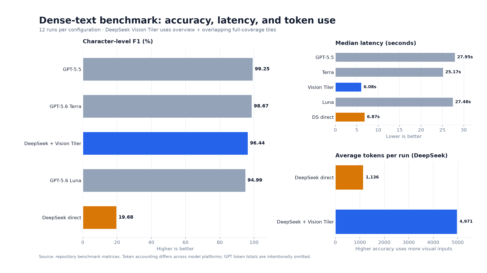
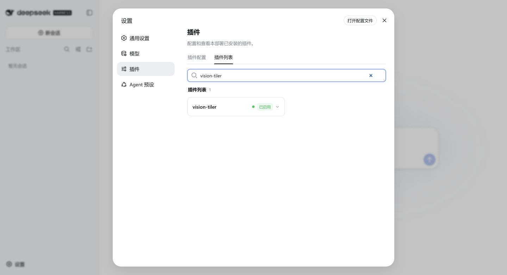

# DSH Vision Tiler

[中文说明](README.zh-CN.md) · [Technical report](docs/DSH视觉分块插件v2技术报告.md) · [Dense-text benchmark](docs/密集文字识别五模型补充报告.md)

Full-coverage image tiling for DeepSeek Harness (DSH) vision models. The plugin turns one high-resolution image into a global overview, overlapping coverage tiles, and an optional dense-region detail crop before the model reads it.



## Why it exists

DeepSeek documents a maximum of 384 vision tokens per image and scales large images before inference. That budget is often enough for ordinary photos, but it can remove small characters from receipts, tables, diagrams, and long screenshots. DSH Vision Tiler gives each local region its own image budget while preserving a complete, auditable view of the source.

- **100% geometric coverage:** coverage tiles are audited against every source pixel.
- **Overlapping seams:** text and shapes that cross a tile edge remain visible in a neighbour.
- **Content-aware cuts:** document mode moves horizontal seams toward low-ink areas.
- **Dense-region review:** an optional 512×512 detail crop supplements, never replaces, base coverage.
- **Bounded batches:** large tile sets are returned in model-safe batches.
- **Traceable output:** each tile carries source coordinates, role, batch state, coverage, and a conservative token cap.
- **No native image build:** v0.2.3 uses pure JavaScript plus bundled WebAssembly, avoiding `sharp`/libvips conflicts inside DSH Web.

## Install

Requirements: DeepSeek Harness, a vision-capable DSH model profile, and Node.js 22 or later.

Pinned GitHub release:

```shell
dsh plugin --profile web add github:zyh20041227/improved_vision_for_deepseek#v0.2.3
dsh --profile web --dump-config
```

No `allow-build` entry is required. Runtime packages are declared in `package.json` and locked in `package-lock.json`; these files are the Node.js equivalent of Python's `requirements.txt`. An npm registry release is planned but is not yet published, so use the pinned GitHub command above.



## Use

Ask the model to call the registered `segment_image` tool and continue through every returned batch:

```text
Call segment_image for D:\images\document.png with mode=document and batch_index=0.
If remaining_batch_indices is not empty, read every remaining batch before answering.
Report uncertain_regions and cite the tile IDs used.
```

| Argument | Meaning |
|---|---|
| `path` | Absolute path, or a path relative to the DSH process directory |
| `mode` | `auto`, `document`, `diagram`, or `photo` |
| `strategy` | `adaptive` (default) or `uniform` (control mode) |
| `batch_index` | Zero-based output batch |

The DSH profile must use a model that accepts image attachments. A text-only route can run the tiler, but it cannot pass the resulting images to the model.

## Measured results

The controlled dense-text benchmark contains four synthetic pages with 100 unique eight-character codes each. Every model arm read each page independently three times: 12 calls and 1,200 exact-code decisions per arm.

| Configuration | Exact-code F1 | Median latency | Mean total tokens/call | Estimated cost/call |
|---|---:|---:|---:|---:|
| GPT-5.5 | 99.25% | 27.95 s | Not exposed | Codex subscription; not convertible |
| GPT-5.6 Terra | 98.67% | 25.17 s | Not exposed | Codex subscription; not convertible |
| **DeepSeek + plugin** | **96.44%** | **6.08 s** | **4,970.8** | **¥0.004521** observed-cache estimate |
| GPT-5.6 Luna | 94.99% | 27.48 s | Not exposed | Codex subscription; not convertible |
| DeepSeek direct image | 19.68% | 6.87 s | 1,135.5 | ¥0.001830 estimate |

For this task, tiling increased the estimated DeepSeek charge per call by about 2.47×, but reduced estimated cost per 100 correct codes by about 51%. DeepSeek's experimental vision model has no separate public price row, so these values use the published V4 Flash rates and are estimates, not invoices. Codex does not expose per-task vision tokens or billable API cost here, so GPT prices are intentionally not guessed.

### Does the 384-token cap reduce reading quality?

It can, especially when a large image contains small, low-contrast, or tightly packed text. In the controlled test, the model and prompt stayed the same while the input changed from one scaled image to complete local tiles; F1 rose from 19.68% to 96.44%. This is strong engineering evidence for that workload, not a claim that every image needs tiling.

## How it works

1. Decode PNG/JPEG/BMP/GIF/TIFF with Jimp and WebP with bundled WASM.
2. Apply EXIF orientation and reject images above the 100-million-pixel safety limit.
3. Generate a downscaled overview.
4. Plan overlapping tiles whose union covers the full oriented source.
5. In adaptive document mode, move seams toward low-density rows and select optional dense details.
6. Audit coverage, encode PNG attachments, and return bounded batches with coordinates.

The plugin guarantees geometric pixel coverage. It cannot guarantee that a model semantically recognises every visible character; blurred input, compression artefacts, unusual fonts, and model errors still require review.

## Evidence and reproducibility

- [v2 technical report](docs/DSH视觉分块插件v2技术报告.md)
- [Five-model dense-text report](docs/密集文字识别五模型补充报告.md)
- [Dense-text raw matrix](benchmarks/dense-text-matrix.json)
- [Five-model raw matrix](benchmarks/five-model-matrix.json)
- [Experiment runner](experiment/README.md)

The public repository contains aggregate results and reproducible generators, but never API keys or local caches.

## Development

```shell
npm install
npm test
npm pack
```

The test suite covers exact geometric coverage, seam overlap, safety caps, deterministic batching, adaptive detail selection, WebP/WASM decoding, EXIF orientation, and DSH tool rendering. See [CONTRIBUTING.md](CONTRIBUTING.md) and [SECURITY.md](SECURITY.md).

## License

MIT
