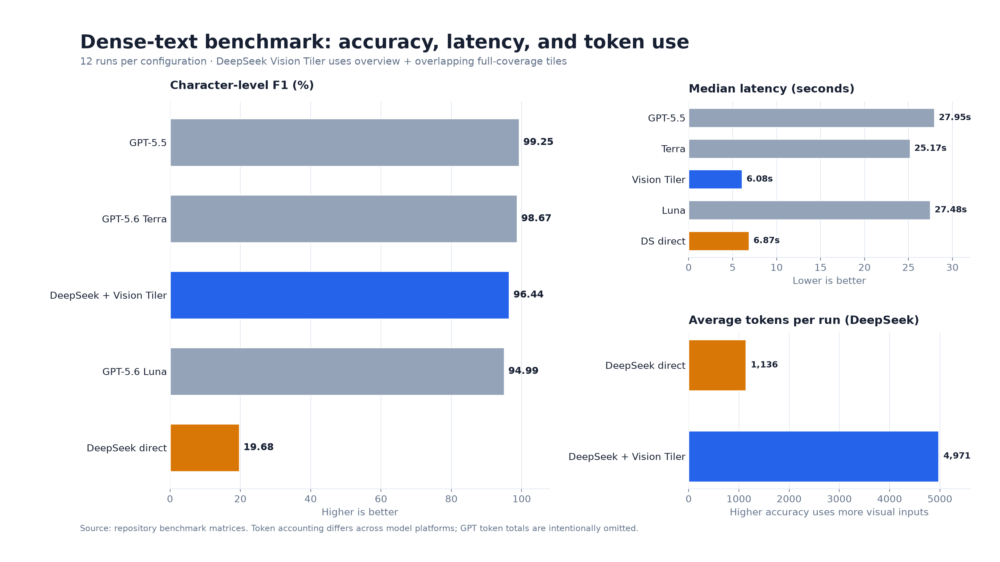
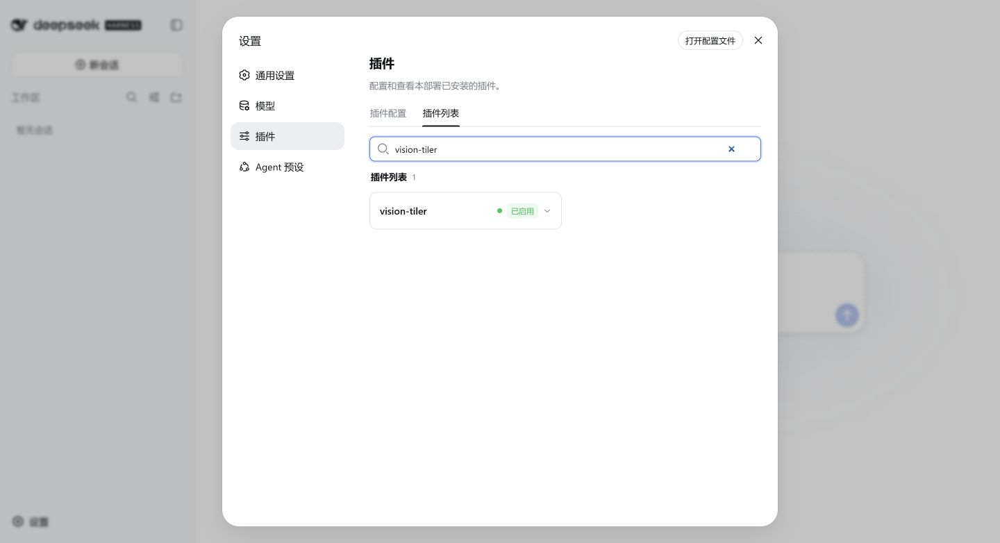

# DSH Vision Tiler

[English](README.md) · [技术报告](docs/DSH视觉分块插件v2技术报告.md) · [密集文字基准](docs/密集文字识别五模型补充报告.md)

这是一个面向 DeepSeek Harness（DSH）视觉模型的完整覆盖图片分块插件。它会在模型读图前生成全局预览、带重叠的基础切片，以及可选的密集区域放大图。



## 为什么需要它

DeepSeek 文档说明：大图进入模型前会缩放，每张图片最多消耗 384 个视觉 token。普通照片通常够用，但长收据、表格、密集小字、流程图和长截图可能在整图缩放后丢失细节。本插件让每个局部区域获得独立图片预算，同时保证原图各部分都被覆盖。

- **100% 几何覆盖**：基础切片的并集覆盖方向校正后的每个源像素，并返回审计结果。
- **切缝重叠**：落在边缘的文字或图形仍能在相邻切片中看到。
- **内容感知切缝**：文档模式优先把横向切缝移动到低墨迹区域。
- **密集区复核**：可补充 512×512 密集区域放大图，但不替代基础覆盖。
- **有界批次**：切片过多时分批返回，避免单次图片数量过大。
- **可追踪输出**：返回原图坐标、切片角色、批次、覆盖率和保守 token 上限。
- **不含原生图像构建**：v0.2.3 使用纯 JavaScript 与随包 WebAssembly，规避 DSH Web 中的 `sharp`/libvips 冲突。

## 安装

要求：DeepSeek Harness、支持图片输入的 DSH 模型配置，以及 Node.js 22 或更高版本。

固定到 GitHub 发布版本：

```shell
dsh plugin --profile web add github:VoidForge/dsh-vision-tiler#v0.2.3
dsh --profile web --dump-config
```

不再需要配置 `allow-build`。运行依赖已写入 `package.json`，精确版本由 `package-lock.json` 锁定；这两个文件就是 Node.js 项目对应 Python `requirements.txt` 的机制。npm 公共包尚未发布，因此当前请使用上面的 GitHub 固定版本命令。



## 调用

让模型调用注册的 `segment_image` 工具，并读取所有返回批次：

```text
请调用 segment_image 读取 D:\images\document.png，使用 mode=document、batch_index=0。
如果 remaining_batch_indices 不为空，请读完所有剩余批次后再回答；
最后列出 uncertain_regions，并注明使用过的切片 ID。
```

| 参数 | 说明 |
|---|---|
| `path` | 绝对路径，或相对于 DSH 进程目录的路径 |
| `mode` | `auto`、`document`、`diagram` 或 `photo` |
| `strategy` | `adaptive`（默认）或 `uniform`（对照模式） |
| `batch_index` | 从 0 开始的输出批次 |

DSH profile 必须使用支持图片附件的模型。纯文本模型可以执行分块，但无法把生成的图片交给模型读取。

## 实测结果

受控密集文字基准包含 4 张合成页面，每页 100 个唯一 8 位随机码。每个模型对每页独立运行 3 轮，即每组 12 次调用、1,200 个严格整码判断。

| 配置 | 严格整码 F1 | 中位延迟 | 平均总 token/次 | 估算价格/次 |
|---|---:|---:|---:|---:|
| GPT-5.5 | 99.25% | 27.95 秒 | 不可观测 | Codex 订阅内，无法换算 |
| GPT-5.6 Terra | 98.67% | 25.17 秒 | 不可观测 | Codex 订阅内，无法换算 |
| **DeepSeek + 插件** | **96.44%** | **6.08 秒** | **4,970.8** | **¥0.004521**（观察缓存估算） |
| GPT-5.6 Luna | 94.99% | 27.48 秒 | 不可观测 | Codex 订阅内，无法换算 |
| DeepSeek 单图直读 | 19.68% | 6.87 秒 | 1,135.5 | ¥0.001830（估算） |

在这个任务中，插件版单次估算费用约为直读的 2.47 倍，但每 100 个正确整码的估算成本下降约 51%。视觉实验模型没有单独公开价格，因此 DeepSeek 金额按公开 V4 Flash 费率估算，不等同于最终账单。Codex 当前不暴露三种 GPT 模型的任务级视觉 token 和可计费金额，所以不猜测其价格。

### 384 token 上限会降低读图质量吗？

会，至少在“大图 + 密集小字 + 低对比”组合下可能非常明显。同一个 DeepSeek 模型、同一提示词，仅把输入从一张缩放整图改为完整局部切片，F1 从 19.68% 提升到 96.44%。这是该类任务的工程证据，并不表示所有普通图片都应分块。

## 实现逻辑

1. PNG/JPEG/BMP/GIF/TIFF 使用 Jimp 解码，WebP 使用随包 WASM 解码。
2. 应用 EXIF 方向，并拒绝超过 1 亿像素的异常图片。
3. 生成全局缩略图。
4. 规划带重叠的切片，使其并集覆盖完整原图。
5. 自适应文档模式把切缝移向低密度行，并可选取密集区放大。
6. 审计覆盖率、编码 PNG 附件，并按批返回坐标和状态。

插件保证的是几何意义上的像素覆盖，不能保证模型语义上识别每个字符。模糊、压缩伪影、异常字体和模型错误仍需人工复核。

## 证据与复现

- [v2 技术报告](docs/DSH视觉分块插件v2技术报告.md)
- [五模型密集文字补充报告](docs/密集文字识别五模型补充报告.md)
- [密集文字原始矩阵](benchmarks/dense-text-matrix.json)
- [五模型原始矩阵](benchmarks/five-model-matrix.json)
- [实验运行说明](experiment/README.md)

公开仓库包含汇总结果和可复现生成器，不包含 API 密钥或本地缓存。

## 开发与测试

```shell
npm install
npm test
npm pack
```

测试覆盖几何完整性、切缝重叠、安全上限、确定性批次、自适应密集区域、WebP/WASM、EXIF 方向和 DSH 工具渲染。参与开发请看 [CONTRIBUTING.md](CONTRIBUTING.md)，安全问题请看 [SECURITY.md](SECURITY.md)。

## 许可证

MIT
