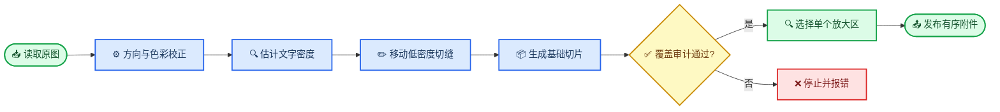

# DSH 视觉分块插件 v2：五组多轮对照与工程评估

_DeepSeek Vision Tiler 0.2.0 · 2026-08-23 · Asia/Shanghai_

---

## 📋 摘要

本报告比较 GPT-5.5、GPT-5.6 Luna、GPT-5.6 Terra、无插件 DeepSeek Vision 和使用优化插件的 DeepSeek Vision。实验使用 ICDAR 2019 SROIE 的 4 张长收据（008–011），每组对每张图片独立运行 3 轮，共 12 次观测。选择长图子集是因为这些图片会实际触发分块；小图不触发插件，无法回答分块是否有效。数据来自 SROIE 公开镜像。[^1]

最终的单放大区 v2 插件取得最高平均唯一词召回率 97.62% 和 F1 96.80%。相较无插件 DeepSeek，召回率提高 3.20 个百分点，F1 提高 2.69 个百分点；中位延迟由 4.68 秒增至 16.23 秒，输入 token 由每次 424 个增至 2,164 个。按 2026-08-23 核实的 DeepSeek V4 Flash 公布价估算，观察到的平均费用约为每次 0.00183 元；按全部缓存未命中的保守口径约为 0.00289 元。实验视觉模型未在价格页单独列价，因此金额属于估算值。[^2]

> ⚠️ **结论边界：** 这是面向“长文档完整读取”的工程基准，不是通用视觉能力排行榜。Codex 三模型通过代理任务和本地图片查看工具运行，DeepSeek 通过 API 运行，因此延迟、token 和价格并非完全同口径。

## 🔬 实验设计

### 实验单位与重复

实验单位是图片，技术重复是同一模型对同一图片的 3 次独立读取。4 张图片 × 3 轮得到每组 12 次观测。重复轮次用于观察服务和生成波动，不把 12 次技术重复误当成 12 张独立图片。

| 项目 | 设置 |
| --- | --- |
| 数据 | SROIE 008–011 |
| 图片类型 | 英文长收据、密集小字 |
| 主指标 | 唯一词召回率、精确率、F1 |
| 性能指标 | 中位延迟、P95 延迟 |
| 资源指标 | prompt/completion token、图片数 |
| 成本指标 | 实际缓存口径、全未命中口径 |
| 重复次数 | 每图每组 3 轮 |

### 五个主对照组

| 对照组 | 输入方式 | 执行环境 |
| --- | --- | --- |
| GPT-5.5 | 单张原图 | Codex，medium reasoning |
| GPT-5.6 Luna | 单张原图 | Codex，medium reasoning |
| GPT-5.6 Terra | 单张原图 | Codex，medium reasoning |
| DeepSeek 无插件 | 单张原图 | 官方视觉 API，关闭思考模式 |
| DeepSeek v2 插件 | 全局图 + 基础切片 + 1 张自适应放大图 | 官方视觉 API，关闭思考模式 |

DeepSeek 官方说明，大图会在进入模型前缩放，每张图片视觉 token 上限为 384；多张图片分别计算。[^3] 因此分块的核心代价是把单图视觉预算扩展为多图预算，而不是免费提升清晰度。

### 公平性限制

- Codex 任务使用中文盲测指令，DeepSeek API 使用等价英文指令，提示词不是逐字相同
- Codex 延迟包含代理规划和图片查看工具调用，DeepSeek 延迟是 API 非流式请求总时间
- Codex 当前任务接口没有返回可计费 input/image token 或任务级金额
- GPT 三组价格属于 Codex 订阅消耗，不能与 DeepSeek 按 token 账单直接换算
- 唯一词指标忽略词序，适合衡量“有没有读到”，不等价于严格版面 OCR 或字符错误率

## 📊 五组结果

### 准确率、延迟与价格

| 组别 | 召回率 | 精确率 | F1 | 中位延迟 | P95 | Prompt / 次 | 价格 / 次 |
| --- | ---: | ---: | ---: | ---: | ---: | ---: | ---: |
| DeepSeek + v2 插件 | 97.62% | 95.99% | 96.80% | 16.23 s | 22.54 s | 2,164 | ¥0.00183 估算；¥0.00289 冷缓存 |
| GPT-5.5 | 95.40% | 94.75% | 95.07% | 17.98 s | 62.82 s | 不可观测 | 订阅内，不可换算 |
| GPT-5.6 Terra | 94.78% | 95.12% | 94.95% | 21.91 s | 81.32 s | 不可观测 | 订阅内，不可换算 |
| DeepSeek 无插件 | 94.43% | 93.79% | 94.10% | 4.68 s | 7.13 s | 424 | ¥0.00117 估算 |
| GPT-5.6 Luna | 93.81% | 93.90% | 93.85% | 20.72 s | 58.57 s | 不可观测 | 订阅内，不可换算 |

DeepSeek 两组的 completion token 接近：无插件平均 374 个，插件平均 363 个。插件增加的主要是视觉输入，而非输出长度。插件组平均发送 6.5 张图片，无插件固定为 1 张。

### 逐图片召回率

| 组别 | 008 | 009 | 010 | 011 |
| --- | ---: | ---: | ---: | ---: |
| GPT-5.5 | 90.2% | 99.7% | 96.3% | 95.5% |
| GPT-5.6 Luna | 90.2% | 99.1% | 91.3% | 94.8% |
| GPT-5.6 Terra | 90.5% | 98.8% | 96.3% | 93.6% |
| DeepSeek 无插件 | 88.6% | 100.0% | 92.5% | 96.6% |
| DeepSeek + v2 插件 | 95.2% | 100.0% | 97.5% | 97.8% |

插件在 4 张长图上均不低于无插件，其中最困难的 008 提高约 6.7 个百分点。009 已存在天花板效应，两组均为 100%。

## ⚙️ v2 插件实现

### 数据流

### 新增机制

1. **内容感知切缝：** 对低分辨率灰度图组合暗度和边缘变化生成密度图，在保持重叠与无缝覆盖的约束下，把水平切缝移动到低密度区域
2. **基础覆盖与细节分离：** `BASE` 切片负责 100% 几何覆盖；`DETAIL` 只负责放大最密集区域，不参与覆盖保证
3. **单放大区默认值：** 512×512 高密度区域默认只选 1 个；数量仍可配置为 0–16
4. **双重审计：** 发布附件前检查边界合法性和精确二维覆盖，未覆盖像素不为 0 时停止
5. **阅读清单：** 输出明确要求先看全局图、逐个读取 `BASE`、再用 `DETAIL` 复核，并报告 `seen_tiles`、`edge_checks` 与 `uncertain_regions`
6. **兼容模式：** `strategy=uniform` 可复现 v1 固定网格，便于回归和消融

DSH 插件通过公开工具注册接口暴露 `segment_image`，并通过附件服务有序保存图片。[^4][^5]

## 🔍 消融与折中

| 策略 | 召回率 | F1 | 图片 / 次 | Prompt / 次 | 中位延迟 | 冷缓存价格 / 次 |
| --- | ---: | ---: | ---: | ---: | ---: | ---: |
| 无插件 | 94.43% | 94.10% | 1.0 | 424 | 4.68 s | ¥0.00117 |
| v1 固定分块 | 97.15% | 96.33% | 5.5 | 1,940 | 12.62 s | ¥0.00267 |
| v2 自适应 + 1 放大区 | 97.62% | 96.80% | 6.5 | 2,164 | 16.23 s | ¥0.00289 |
| v2 自适应 + 2 放大区 | 97.54% | 96.72% | 7.5 | 2,388 | 14.81 s | ¥0.00312 |

单放大区在本数据上比双放大区略高 0.08 个百分点 F1，同时少 224 个 prompt token，因此被选为默认值。双放大区中位延迟偶然更低，但 P95 更高；由于只有 12 次观测，这种网络时延差异不应解释为结构性优势。

按最新公开价和实验中观察到的缓存命中情况估算，12 次单放大区调用总计约 ¥0.02200；按全部缓存未命中计算约 ¥0.03467。2026-08-23 核实的 DeepSeek V4 Flash 价格为缓存命中输入 ¥0.02/百万 token、未命中输入 ¥1/百万 token、输出 ¥2/百万 token。实验使用的视觉实验模型没有单独公开价，故不能把该估算视为最终账单。[^2]

## 🎯 结论与建议

1. **需要完整读取长文档时使用 v2：** 它在本次基准中取得最高召回率和 F1，并消除 008 上最明显的整图缩放损失
2. **低延迟优先时关闭插件：** 无插件 DeepSeek 的中位延迟只有 4.68 秒，适合普通照片或不含密集小字的图片
3. **默认使用一个放大区：** 它是本实验准确率、token 与价格的最好折中；仅在高风险文档中提高 `detailCropCount`
4. **不要把几何覆盖当成语义保证：** 插件能证明每个源像素至少位于一个基础切片中，但不能证明模型识别正确
5. **下一版采用按需二阶段放大：** 先让模型报告低置信坐标，再只生成对应放大图，可望比固定添加放大图进一步降低 token

在当前五组设置下，DeepSeek + v2 插件适合准确率优先；DeepSeek 无插件适合延迟和成本优先；GPT-5.5 是三个 Codex 原图直读模型中表现最好的。由于 Codex 不返回任务级计费数据，不能从本实验得出 GPT 与 DeepSeek 的精确价格比。

## 🔗 参考资料

[^1]: zzzDavid. “ICDAR 2019 SROIE public mirror.” GitHub. https://github.com/zzzDavid/ICDAR-2019-SROIE

[^2]: DeepSeek. “模型 & 价格.” DeepSeek API Docs. https://api-docs.deepseek.com/zh-cn/quick_start/pricing

[^3]: DeepSeek. “图像理解：Token 用量.” DeepSeek API Docs. https://api-docs.deepseek.com/zh-cn/guides/vision

[^4]: DeepSeek AI. “Adding a Tool.” DeepSeek Harness. https://github.com/deepseek-ai/deepseek-harness/blob/master/docs/cookbook/adding-a-tool.md

[^5]: DeepSeek AI. “Attachment subsystem.” DeepSeek Harness. https://github.com/deepseek-ai/deepseek-harness/blob/master/docs/subsystems/attachment.md

---

_最后更新：2026-08-23_
